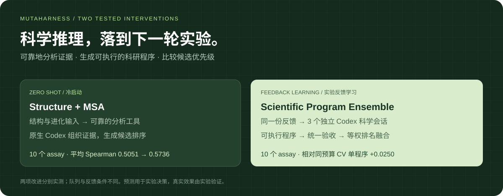

# MutaHarness

**把大模型的科学推理，变成分子研发中可执行、可检查的实验决策。**



研发团队面对的问题很具体：**有几百个候选突变，实验预算有限，下一批应该测哪些？**

这里的 *fitness* 指实验关心的分子性能，例如活性、结合能力、荧光或稳定性。预测它们的相对高低，能帮助定向进化选择候选；实验反馈再用于改进下一轮。零样本负责冷启动，少样本负责从测量中学习。这是蛋白药物和酶优化的一个关键环节。

本项目整理了两项已经完成实验的 Codex 任务 Harness 改进，保留原生科学会话、生成代码、逐条预测与对照。**下列数字均来自此前已完成的实验记录。**

## 两项改进

| 改进 | 怎样改变工作方式 | 解决什么问题 |
|---|---|---|
| **Scientific Program Ensemble** | 同一份实验反馈交给3个独立原生 Codex 会话；各自提出、验证并交付可执行预测程序，最后等权融合排名 | 科学建模有多种合理假设，单次会话容易依赖一种；程序集成利用不同方案的互补性 |
| **Structure + MSA 工具** | 提供结构坐标、同源序列比对及可靠分析工具；模型按实验目标选择和组织证据 | 序列文字不足以说明突变的空间环境与进化容忍度；长原始文件还容易引入编号和证据解释错误 |

MSA 是“许多自然同源序列如何在同一位置变化”的对照表；结构说明这个位置在空间中的环境。两者是证据，实验测量仍是最终检验。

模型仍使用官方 Codex 的原生工具与科学建模能力。项目扩展的是它在分子研发任务上的输入、执行、验证和聚合流程。[方法与实例 →](docs/method.md)

## 已有实测

模型：`gpt-6.1-sol`，`high`，Fast 关闭。Spearman 衡量预测排序和实验排序的一致程度，越高越好。

| 实验 | 对照 → 改进 | 已有结果 |
|---|---|---|
| 零样本：10个 protein / PPI assay，每个250候选 | 基础原生 Codex → Structure + MSA | 平均 **0.5051 → 0.5736**，**7/10** 提升 |
| 反馈学习：10个 protein assay，每个96条反馈、186候选 | 单次原生 Codex → Scientific Program Ensemble | 平均 Spearman **+0.0221**，**8/10** 提升 |
| 同一组三个程序、相同生成预算 | 用反馈CV选一个 → 三程序排名融合 | 平均 Spearman **+0.0250**，**8/10** 提升 |

例如，零样本 AMFR 的排序相关性从 **0.4340 → 0.6574**；程序集成在 YAP1 上相对同预算单程序提升 **0.0803**。完整结果也保留 PABP、PHOT 等下降案例。

两项改进分别实测，反馈量、候选和任务队列不同，不能将提升相加。程序集成耗用3个科学会话；同预算CV对照用于区分“多跑几次”和“集成”本身的收益。追加 protein 批次原有一次容量失败，后来用一次交付调用恢复不变代码，原失败与未知用量均保留。合并统计为描述性结果。[全部表格、成本与边界 →](docs/results.md)

## 看结果、读代码、复用流程

- **交互查看**：[打开 demo/index.html](demo/index.html)，或下载仓库后双击该文件。展示已有结果和候选排名，无模型调用。
- **岗位与任务**：[四类研发岗位、时间分布、每类任务的 query + input](docs/roles-and-queries.md)。时间比例明确标为典型工作周估计。
- **可复用 Skill**：[Scientific Program Ensemble](.agents/skills/scientific-program-ensemble/SKILL.md)。
- **原始证据**：[程序集成](evidence/scientific_program_ensemble/)、[零样本首批](evidence/protein_zero_native01/)、[零样本新增六个](evidence/protein_zero_native02/)。

可选的冷启动重放会从传入的96条反馈重新拟合冻结程序，核对输出与已有记录；不请求新模型，也不读测试标签：

```bash
python3 -m venv .venv
.venv/bin/pip install -r requirements.txt
.venv/bin/python demo.py --case gfp_s2501 --out outputs/gfp_replay
```

代码和输入来源、打包范围见 [provenance](docs/provenance.md)。本项目演示的是公开历史实验的离线决策；没有进行新湿实验，也不把分数提升等同于药效提升。
