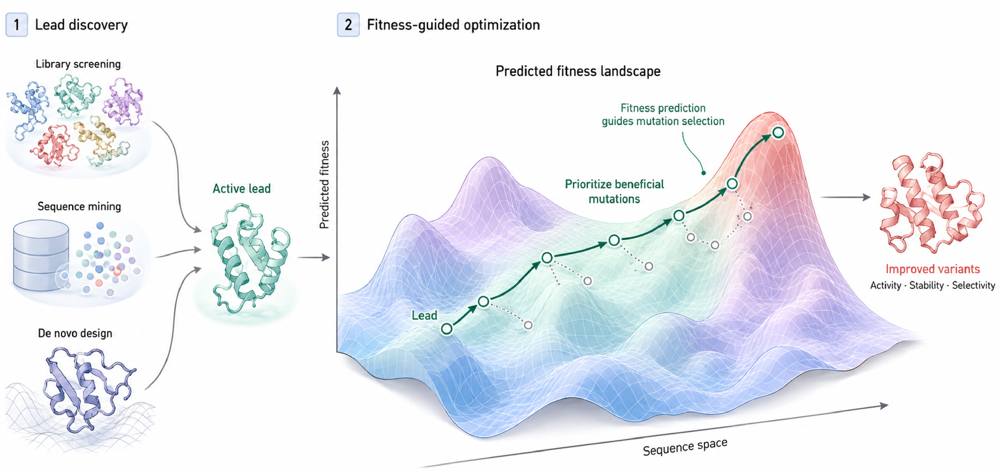
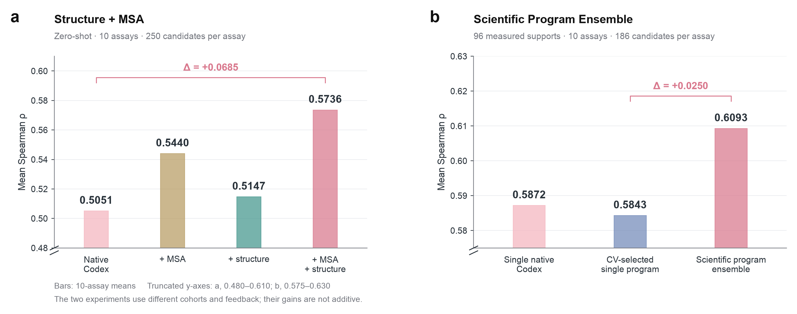
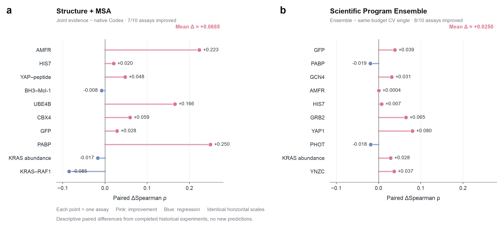
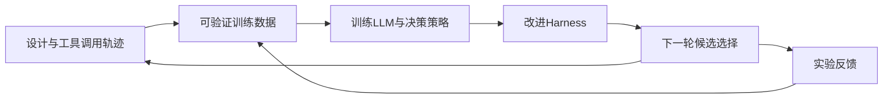

# MutaHarness

从筛选、序列挖掘或从头设计中找到一个有用的分子后，研发还需要反复改造和测试，才能改善活性、稳定性或选择性。**Fitness预测帮助决定下一轮值得测试哪些突变；实验反馈再用于更新预测。** 这是定向进化与 lab-in-the-loop 中连接计算和实验的环节。



*概念示意图。Fitness指具体实验关心的分子性能；本项目聚焦右侧的突变排序与反馈学习。*

Task Option 2：下面先说明研发岗位与任务，再用LLM能力评估和MutaHarness两组已有实验，讨论LLM的预测能力、Harness改进和后续研究。

## 1. 行业岗位：谁在做什么？

蛋白药物、酶和生物制造的研发，通常围绕 **设计 → 制备 → 测试 → 学习 → 再设计** 展开。蛋白工程科学家决定优化目标，计算团队推荐候选，实验团队测量效果，工程师保证数据和设备流程能接起来。小团队中，一人可能兼任多个职责。

以下岗位参考 [Cradle 的研发工作流](https://www.cradle.bio/)、[实验室与自动化介绍](https://www.cradle.bio/lab)及 [Novonesis 的研发岗位](https://www.novonesis.com/en/careers/areas-of-work/research-and-development)。**时间比例是典型工作周的估计，每个岗位合计100%，不是企业工时调查。** 每行给出一条代表性 query 和输入示例。

这里的 WT 是未改造的参考蛋白；MSA 是把许多同源蛋白序列对齐后得到的“自然变化对照表”。

### 蛋白工程科学家：确定目标、设计突变

| 时间 | 任务 / 场景 | 代表性 query | input |
|---:|---|---|---|
| **25%** | 文献与目标定义 | 把这个酶的优化目标转成可测指标，列出可能冲突的性质。 | 目标反应、温度/pH、现有性能、机制论文 |
| **35%** | 突变库设计 | 只能测一块96孔板，优先选哪些突变？给出依据和风险。 | WT序列、候选、结构、MSA、实验预算 |
| **25%** | 解释结果、设计下一轮 | 哪些失败更像表达问题，哪些更像功能受损？下一轮如何区分？ | 表达量、活性、稳定性、重复实验、上一轮预测 |
| **15%** | 评审与实验交接 | 把候选列表整理成实验员可以核对的设计单。 | 突变编号、参考序列版本、构建方案、优先级 |

### 计算生物学 / ML 科学家：预测与反馈学习

| 时间 | 任务 / 场景 | 代表性 query | input |
|---:|---|---|---|
| **25%** | 数据整理与编号对齐 | 检查这些文件是否指向同一个蛋白，统一残基编号。 | FASTA、结构PDB、比对A2M、实验CSV、元数据 |
| **35%** | **零样本 fitness 预测** | 没有本项目实验标签，给这批突变排出功能优先级。 | WT、候选、结构、MSA；不含fitness标签 |
| **25%** | **少样本反馈更新** | 拿到一批实验结果后，重排未测候选，说明策略变化。 | 上述证据、已测的突变→fitness、未测列表 |
| **15%** | 评估与误差分析 | 比较两种方法选出的前10个，检查收益来自哪里。 | 固定划分、预测、独立保管的标签、运行记录 |

### 实验研发科学家 / 研究助理：执行与测量

| 时间 | 任务 / 场景 | 代表性 query | input |
|---:|---|---|---|
| **30%** | 构建、表达、样品准备 | 检查构建单的序列与突变编号是否一致。 | 参考序列、设计序列、引物/构建单、样品ID |
| **35%** | 测定与筛选 | 给这批样品安排重复、阳性/阴性对照和板位。 | 样品、读出指标、板规格、对照、操作约束 |
| **20%** | 质量检查与归一化 | 标出异常孔，按既定规则归一化；保留失败样本。 | 原始读数、板位图、对照、批次、重复ID |
| **15%** | 记录与反馈回传 | 输出计算团队可直接读取的结果，保留测量不确定性。 | 样品ID、归一化结果、重复统计、质量标记 |

### 实验自动化 / 数据平台工程师：维护设备与数据流程

| 时间 | 任务 / 场景 | 代表性 query | input |
|---:|---|---|---|
| **35%** | 自动化开发与排障 | 定位这次移液流程中断的位置，给出可验证的恢复方案。 | 设备日志、流程版本、板位状态、故障码 |
| **30%** | 样品追踪与系统集成 | 对齐样品、构建序列与实验结果，找出重复或缺失ID。 | 样品管理系统导出、序列版本、板位图、结果表 |
| **20%** | 计算工具维护 | 让结构/MSA处理失败时明确报错，而不是返回空证据。 | 工具接口、失败文件、日志、输入输出规范 |
| **15%** | 监控与审计 | 复核这份排序由哪个模型、哪些输入和反馈生成。 | 输入哈希、程序版本、调用记录、预测文件 |

## 2. 选择的难题：实验预算有限，下一批测哪些突变？

本项目选择计算岗位中的 **fitness预测与反馈更新**。它是分子定向进化的关键环节：先预测候选性能，挑选一批做实验，再从返回的测量中学习。零样本用于没有本项目实验反馈的冷启动；少样本用于 lab-in-the-loop 中的排序更新。用于蛋白药物时，可以分别服务结合、表达或稳定性等目标。

这项任务的价值在于节省有限的实验名额。难点在于：同一个突变对稳定性和结合能力可能有不同影响；多个突变的效果不一定能相加；少量反馈又允许多种看似合理、泛化不同的模型。大模型能解释这些机制，但直接写出一长串分数，难以保证编号、证据和数百个候选的排序始终一致。

| 场景 | 代表性 query | 本仓库的实际 input | 输出 |
|---|---|---|---|
| 零样本冷启动 | 没有目标实验标签，根据结构和进化证据给这250个突变排序。 | [AMFR输入包](examples/zero_shot/amfr/)：参考序列、候选、结构与MSA证据，无已测反馈 | 每个候选的排序分数、所用证据与预测程序 |
| 少样本反馈学习 | 根据96条已测结果，为剩余186个GFP候选预测荧光排序，交付可执行程序。 | [GFP case.json](inputs/gfp_s2501.json)：序列、实验目标、96条反馈、186个未测候选 | 三份可复核的科研程序、融合排序和程序分歧 |

## 3. LLM能力评估：能预测突变，也能从实验反馈中学习吗？

先评估通用LLM本身的突变效应预测能力：根据实验目标、序列和可用的进化／结构证据给出预测，不进行任务专属微调。多轮实验中，已测结果直接作为上下文提供给LLM；领域模型则用表征＋随机森林（RF）学习反馈。这里的LLM能力包含给定证据和提示下的表现。

### 零样本：与领域预测方法比较

每个数据集（assay）对应一项实验读出，测试250个候选，不提供目标实验反馈。Spearman衡量预测排序与实验排序的一致程度，越高越好。

| 任务 | 共同数据集 | Gemini 3.8 Flash | 代表性领域方法 |
|---|---:|---:|---|
| 蛋白突变效应 | 201 | 0.4824 | ESM2 650M：0.4550；ProSST：0.5359；VenusREM：**0.5441** |
| RNA突变效应 | 10 | **0.4271** | RNAErnie：0.2350；Evo2：0.2172 |

**Protein：LLM超过ESM2等部分方法，较强的结构与进化模型仍有优势。**


**RNA：LLM在这组评测中优于所评估的领域模型。**


柱高为逐实验等权平均，散点为各实验结果，负分完整保留。Gemini的输入配置按已有结果选择：Protein使用序列＋MSA＋结构，RNA使用序列＋MSA。各方法输入不同，这是一组描述性比较。

### 多轮迭代：固定实验预算下的候选选择

在历史实验数据上回放五轮设计：共享32条初始反馈，每轮从一个新的1000候选池选择32条，获得测量后更新下一轮预测。各方法只积累自己选择的后续反馈；第5轮开始前可用160条，结束共192条。

纵轴为所选候选中达到**当前池前10%性能阈值**的比例，越高越好。以下三张图分别使用各自完整五轮的共同实验集合。

| 任务 | 共同实验 | LLM第5轮命中率 | 图中最高的非LLM学习方法 |
|---|---:|---:|---|
| Protein | 47 | **39.16%** | ESM2 650M＋RF：33.05% |
| RNA | 18 | **58.33%** | One-hot＋RF：37.50%（RNA-FM＋RF：36.28%） |
| Protein–Protein | 37 | **35.22%** | One-hot＋RF：28.55%（VenusREM＋RF：23.99%） |

**Protein：从蛋白功能测量中更新候选选择。**


**RNA：从RNA功能测量中更新候选选择。**


**Protein–Protein：从结合相关测量中更新候选选择。**


**这三组回放中，LLM的末轮平均命中率均高于图中的其他学习方法，显示了利用实验反馈进行候选选择的潜力。** 图例中的领域模型与One-hot学习曲线均使用RF；PPI的VenusREM为项目适配版。阴影为实验间均值±SEM，zero-shot水平线为五轮平均参考，Random为随机参考。五轮候选池不同，曲线上升本身不能单独证明反馈的因果收益，也没有新湿实验。[完整协议、参考线定义与源数据](docs/llm-evaluation.md)

**下一步检验：在同一个Codex上，Harness能否进一步改善预测？** 以下两项对照分别考察证据输入和科研程序组织，保留各自的模型、实验范围与指标。

## 4. MutaHarness：两项 Harness 改进

Harness 在这里指模型周围的输入、工具、执行检查与结果聚合流程。模型仍在原生 Codex 科学会话中自由建模。

**Scientific Program Ensemble：集成模型写出的科研程序。** 将同一份反馈交给三个独立会话，各自提出假设、验证并交付可执行预测程序。程序可以采用不同特征、模型和变换。检查输出后，把三份分数转成排名，再等权融合。这样能利用不同科学方案的互补性，降低一次建模选择的影响。

**Structure + MSA：补充证据，并改善分析工具。** 结构提供突变位置的空间环境，MSA提供自然同源序列中的变化信息。工具先核对序列与残基编号，再计算接触、暴露、位点频率等证据，明确返回缺失与置信度。模型据此为具体实验目标组织预测，而不必仅凭序列文字猜测。

[方法、流程图与具体代码示例](docs/method.md) · [可运行 Skill](.agents/skills/scientific-program-ensemble/SKILL.md) · [MSA工具](tools/msa_tools.py) · [结构工具](tools/structure_tools.py)

## 5. 已有实测：相对原生 Codex，有多大收益？

以下均为此前已完成实验的存档结果。测试模型为 `gpt-6.1-sol / high`，Fast关闭。对照是原生 Codex，可使用工具并编写预测程序。以下使用相同的Spearman排序指标。

| 实验 | 对照 | 改进后 | 平均提升 | 提升任务数 |
|---|---:|---:|---:|---:|
| 零样本：基础 → Structure + MSA | 0.5051 | **0.5736** | **+0.0685** | **7/10** |
| 少样本：单次Codex → 三程序集成 | 0.5872 | **0.6093** | **+0.0221** | **8/10** |
| 少样本：同预算CV选单程序 → 三程序集成 | 0.5843 | **0.6093** | **+0.0250** | **8/10** |

**结构与进化证据改善了冷启动排序；程序集成在相同生成预算下，也优于从三个程序中只选一个。** 后一个对照用已测反馈的交叉验证（CV）选程序，能帮助区分“多生成几次”和“融合排名”的收益。



细柱为10个任务的均值。纵轴分别截断为 **0.480–0.610** 和 **0.575–0.630**，图中标有断轴。两项实验独立开展：零样本每任务250个候选、0条反馈；程序集成每任务186个候选、96条反馈，提升不能相加。

具体案例：AMFR零样本 **0.4340 → 0.6574**；GFP在同预算下，CV单程序 **0.5433 → 0.5819**。下面也保留了所有下降案例。



粉红为提升，蓝色为下降。右图为同预算对照。[完整表格](docs/results.md)逐行加粗最高分；[矢量图与绘图源数据](assets/results/README.md)可下载。

结论有明确边界：这是公开历史实验数据上的离线评估。零样本平均Top-25重合率从0.272降至0.244，排序相关性提高并未同步改善前25个选样；单次会话和小规模队列也不足以证明多次运行稳定性。程序集成原有一次容量失败，之后用一次交付调用恢复原代码，失败记录仍保留。没有新湿实验或药效验证。[详细结果、成本与限制](docs/results.md)

## 6. 未来方向：训练模型、学习反馈、积累轨迹

已有结果提示两条可以同时推进的方向：提升LLM本身的突变效应预测能力，以及改善它获取证据、使用工具和学习反馈的方式。下一步重点放在：

1. **用synthetic data训练预测能力。** 从已测训练数据构造突变比较、组合效应、证据分析和逐轮反馈任务。标签与证据可核验，代理评分标明来源和置信度；按蛋白家族与实验任务隔离训练和测试。
2. **让Harness更好地从实验室反馈中学习。** 优化反馈组织、上下文更新、程序选择与集成，并在固定实验预算下评估候选命中率和累计发现，同时关注当前排序相关性与Top-K收益未同步的问题。
3. **让Harness收集可训练的设计trajectory。** 在用户授权下记录目标、工具调用与返回、候选选择、人工修改和实验反馈，保留每一步当时可见的信息。真实使用过程可以为模型和工具决策策略提供新的训练数据。



这三点是后续研究设计，当前仓库交付的是已有实验、可复用流程与离线结果查看。[训练数据与轨迹设计细节](docs/llm-evaluation.md#未来研究设计)

## 7. 代码、交付与复核

工程代码从下面几处读起。排名融合、结果整理和页面交互各自独立，存档核对与页面数据生成只需 Python 3.11+，无需安装科学计算依赖。

| 入口 | 职责 |
|---|---|
| [runtime/ranking.py](runtime/ranking.py) | 候选ID与分数检查、并列排名、等权融合、程序分歧；纯标准库 |
| [demo.py](demo.py) | 可选冷重放：校验哈希、分工作区执行、核对原预测、输出排序 |
| [scripts/results.py](scripts/results.py) | 报告、页面和图表共用的存档读取与指标整理 |
| [scripts/build_viewer.py](scripts/build_viewer.py) | 由数据与 [Markdown模板](docs/results.template.md) 生成结果页和报告 |
| [demo/viewer.js](demo/viewer.js) | 原生JavaScript交互；结构、样式和逻辑分文件维护 |
| [tests/test_ranking.py](tests/test_ranking.py) | 并列、ID对齐、分数尺度变化、缺失与非法输入等边界测试 |

`programs/` 是实测时模型生成的原始科研程序，`tools/` 和 `evidence/` 保留原工具与证据，便于追溯；工程入口的重构没有修改这些存档。

- **交互查看**：下载[仓库ZIP](https://github.com/kevinhyj/MutaHarness/archive/refs/heads/main.zip)，解压后双击 `demo/index.html`。可切换实验和任务、查看分数与已有候选排名；GitHub文件页显示HTML源码。
- **实测证据**：[程序集成](evidence/scientific_program_ensemble/)、[零样本首批](evidence/protein_zero_native01/)、[零样本追加批](evidence/protein_zero_native02/)，包含调用、程序、逐条预测和汇总。
- **复核存档**：`python3 -m scripts.audit_existing` 检查哈希、指标算术和页面数据，不调用模型或执行预测程序。[材料来源与打包范围](docs/provenance.md)

[LLM评估存档核对脚本](scripts/audit_evagent.py)另行检查五张图的来源与指标。本地检查与GitHub CI还使用以下命令：

```bash
python3 -m unittest discover -s tests -v
python3 -m scripts.audit_existing
python3 -m scripts.build_viewer
```

可选的程序重放：从96条反馈重新拟合冻结程序，核对输出与原记录。它不请求新模型，也不读取测试标签。

```bash
python3 -m venv .venv
.venv/bin/pip install -r requirements.txt
.venv/bin/python demo.py --case gfp_s2501 --out outputs/gfp_replay
```
