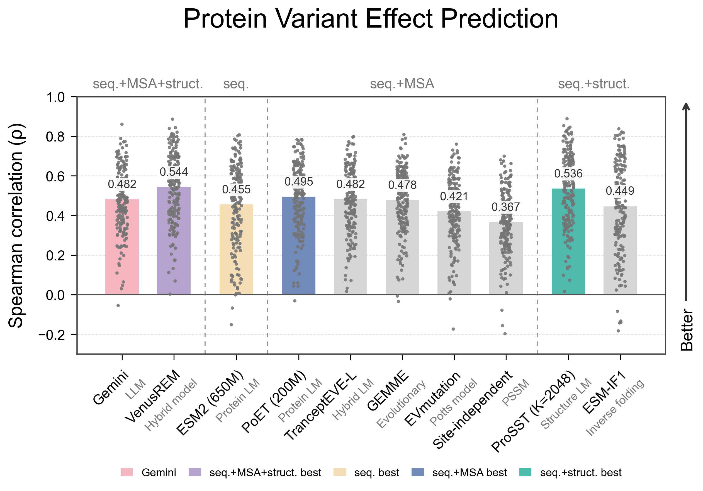
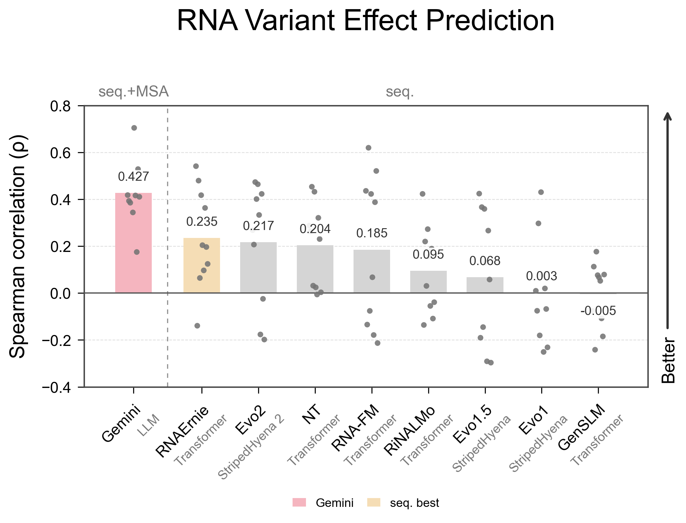
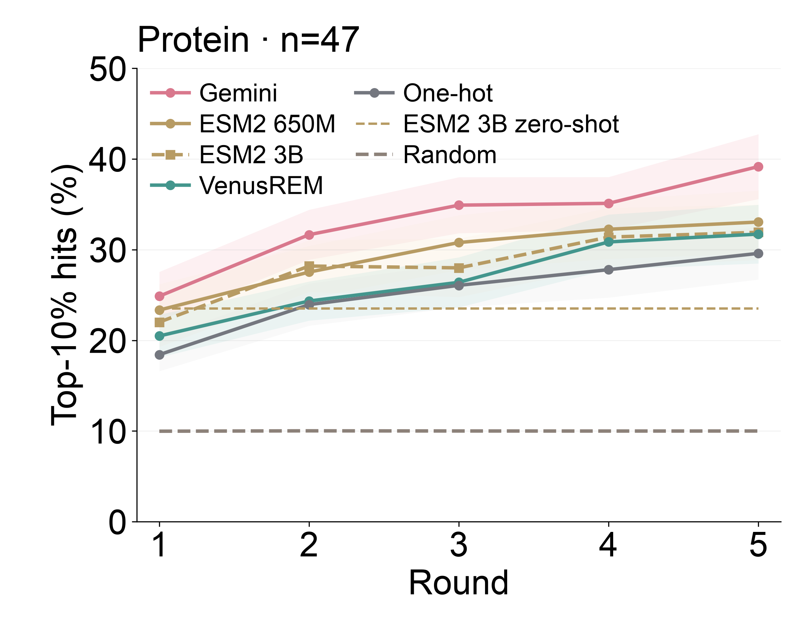
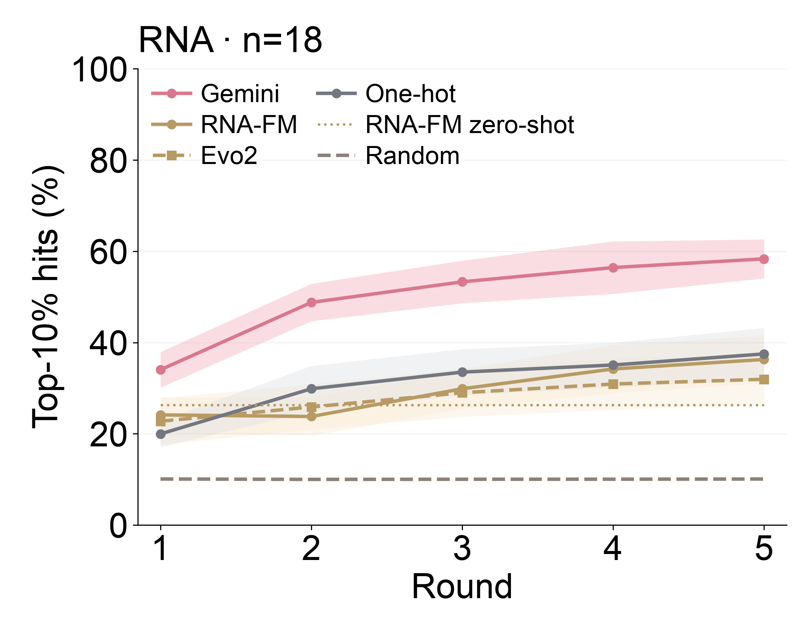
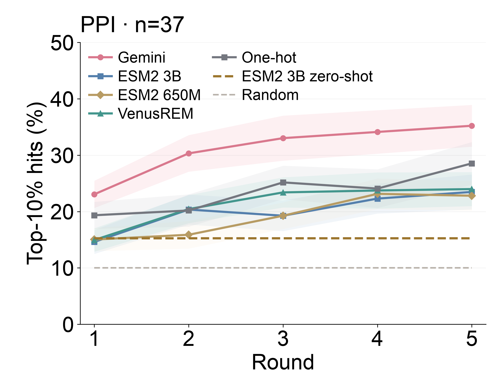

# LLM突变效应评估：协议与未来研究设计

这页整理服务器上的当前成品图及其数据，首次取回日期为2026-10-13，RNA与PPI反馈图于2026-10-14补入。所有数值来自已完成实验；这里只核对文件哈希、共同数据集和保存的指标，不运行模型、拟合预测器或读取逐候选测试标签。

## 两组结果如何连接？

LLM能力评估回答“通用LLM能否预测分子突变效应，与领域方法相比如何”；MutaHarness回答“在同一个原生Codex上，改善证据输入、工具和程序组织能带来多少收益”。两者使用不同的模型、队列和协议，分别报告。

领域对照包括基础模型、统计方法和表征＋回归器。这里没有把这些方法写成商业垂类服务的实测，也没有实测Cradle等商业平台。MutaHarness中的原生Codex对照承担作业要求的通用AI直出比较。

## 零样本：蛋白与RNA

| 项目 | 蛋白 | RNA |
|---|---|---|
| 共同实验数据集 | 201 | 10 |
| 每项测试候选 | 250 | 250 |
| 数据种子 | 42 | 42 |
| Gemini模型请求 | gemini-3.8-flash | gemini-3.8-flash |
| Gemini已测反馈 | 0 | 0 |
| 图中所选输入 | 序列＋MSA＋结构 | 序列＋MSA |
| 保存的对照方法数（含Gemini） | 10 | 9 |
| 指标 | 有符号Spearman，逐实验等权平均 | 同左 |

配置选择与最终比较范围分开：蛋白四种Gemini输入在共同189项上选择，联合输入均值最高，再在与领域基线共同的201项上报告0.4824；RNA在共同10项上选择MSA输入，并用同一10项比较领域基线。选择依据记录在 [best_arm_selection.json](../evidence/evagent/zero_shot/best_arm_selection.json)。因此这些是依据已有结果选配置的描述性比较，不是独立验证最优配置的测试。

### 蛋白原图



[原SVG](../assets/evagent/original_protein.svg) · [原均值CSV](../evidence/evagent/zero_shot/protein_means.csv) · [逐实验指标](../evidence/evagent/zero_shot/protein_per_assay.csv)

### RNA原图



[原SVG](../assets/evagent/original_rna.svg) · [原均值CSV](../evidence/evagent/zero_shot/rna_means.csv) · [逐实验指标](../evidence/evagent/zero_shot/rna_per_assay.csv)

RNA使用当前图的**10项共同数据集**；旧11项融合图对应另一配置，不能混用。各图内方法使用相同的实验ID与测试候选数量，但可用输入、模型预训练与方法类型不同。LLM无目标实验反馈不等于所有对照没有预训练监督。

## 反馈学习：Protein、RNA与Protein–Protein



[原SVG](../assets/evagent/protein_feedback.svg) · [逐轮显示数据](../evidence/evagent/feedback/protein_display_series.csv) · [逐实验逐轮指标](../evidence/evagent/feedback/protein_per_assay_rounds.csv)

每个实验共享随机32条初始测量；随后有五个不重叠的1000候选池，每轮选择32条，只有该方法实际选中的标签进入下一轮。轮前可用反馈为32／64／96／128／160条，结束时共192条。五个池不同，不要求曲线逐轮单调上升。

| 方法 | 第1轮前10%命中率 | 第5轮前10%命中率 |
|---|---:|---:|
| Gemini | **24.87%** | **39.16%** |
| ESM2 650M＋RF | 23.34% | 33.05% |
| ESM2 3B＋RF | 22.01% | 31.91% |
| VenusREM＋RF | 20.48% | 31.72% |
| One-hot＋RF | 18.42% | 29.59% |

专业表征以随机森林（RF）学习反馈，Gemini直接使用反馈与证据，不接RF。Protein输入含可用MSA和WT结构。每轮命中率以当前池冻结的前10%阈值计算，并保留边界并列。

曲线阴影是**实验间均值±SEM**，不是多seed重复或95%置信区间。ESM2 3B zero-shot水平线是同集合五轮平均命中率的参考，实际逐轮值仍在CSV中；随机参考沿用原图。当前所有显示曲线都基于相同47项完整五轮结果。正在运行的EVOLVEpro 15B队列未并入这份已完成结果。

### RNA：18项共同实验



[原SVG](../assets/evagent/rna_feedback.svg) · [显示均值与SEM](../evidence/evagent/feedback/rna_display_series.csv) · [逐实验逐轮指标](../evidence/evagent/feedback/rna_per_assay_rounds.csv)

五轮协议与上面的Protein相同。第5轮Gemini为58.33%，RNA-FM＋RF为36.28%，Evo2＋RF为31.94%，One-hot＋RF为37.50%。RNA使用可用MSA，不加结构。源逐轮CSV包含历史Protein队列，核对时仅取`cohort=rna_common`的18项、9种方法；主图显示其中6种。RNA-FM zero-shot水平线按已有结果选择，是同集合五轮平均参考，不是独立验证的最优基线。

### Protein–Protein：37项共同实验



[原SVG](../assets/evagent/ppi_feedback.svg) · [显示均值与SEM](../evidence/evagent/feedback/ppi_curve_statistics.csv) · [逐实验逐轮指标](../evidence/evagent/feedback/ppi_per_assay_rounds.csv)

BindingGym 13项＋AbAgym 24项，共37项，图中7种方法均完整五轮。第5轮Gemini为35.22%，ESM2 3B＋RF为23.48%，ESM2 650M＋RF为22.80%，VenusREM＋RF为23.99%，One-hot＋RF为28.55%。VenusREM是独立链的项目适配版，不是官方原生PPI复现。

PPI图例省略了重复的“＋RF”，训练方式没有改变。ESM2 3B zero-shot采用独立链WT-marginal PLL，五轮命中率均值为15.27%，画作水平参考；Random为名义10%参考。两者不画SEM。RNA与Protein的随机线保留原图的实际随机均值；三张图的参考线定义不完全相同。

完整版本说明见 [服务器原README](../evidence/evagent/feedback/original_readme.md)。这里的命中率说明固定预算下候选选择的效果，不能直接与Spearman相加。

## 未来研究设计

### 1. 合成数据：训练突变效应预测与证据使用

从独立的训练数据中构造有实验目标的任务：比较两个突变、给候选组排序、解释组合效应、调用MSA或结构工具，以及接收一批反馈后更新判断。任务同时保存证据来源、输入版本和可自动核验的答案。

真实测量提供训练标签；代理模型提供的分数保留方法、置信度与适用范围。科研程序集成可以提供多种候选解法，再通过训练集内的留出样本和输出检查筛选。证据可核验的简短说明与工具行为也可以用于训练。

评估按分子家族和实验任务划分，先冻结验证与测试队列，分别检查单点、多点组合和跨实验目标泛化。保留真实实验标签与代理标签的来源区别，不把测试反馈回流到训练中。

### 2. 反馈学习：优化Harness的决策过程

将每轮实验目标、已测结果、不确定性、失败与剩余预算组织成可更新状态。比较不同的上下文组织、证据选择、程序选择与排名融合策略，让LLM从反馈中修正预测和下一轮选择。

在同一候选库、同一初始反馈与预算下，对比固定流程、无反馈策略和改进流程。同时评估Spearman、Top-K命中率、累计不同高分候选数、失败率和调用成本。用历史库做离线检验，再评估真实实验反馈；这些属于后续研究。

### 3. 使用轨迹：把设计交互变成训练材料

在用户授权下收集可复核的行为与反馈，记录每一步当时可见的信息：

| 轨迹内容 | 用途 |
|---|---|
| 实验目标、参考序列与输入版本 | 明确正在优化什么，防止不同编号和目标混合 |
| 当时可用的证据与已测反馈 | 重建决策时的信息范围 |
| 工具名称、参数、返回与失败 | 训练证据获取、工具选择与错误恢复 |
| 候选排序、用户选择与人工修改 | 学习候选比较和科学家判断 |
| 后续实验结果、质量标记与不确定性 | 评价选择的实际效果，构造反馈学习任务 |
| 调用成本、时间与停止原因 | 评价有限预算下的策略 |

工具返回和后续测量分别落在发生的步骤，不用后来结果改写早先决策。把轨迹转成监督学习或偏好比较任务，再检验能否提升未见分子上的预测与工具决策。当前仓库保留了原Codex会话记录；真实用户设计轨迹的采集、训练和在线学习尚未实现。

## 来源与复核

[导入清单](../evidence/evagent/manifest.json)记录服务器绝对路径、每份文件的SHA-256、实验范围及高清概念图来源。主README展示两张零样本原图和三张反馈原图，均按字节复制。另保留全部19个方法的紧凑概览。逐实验和逐轮CSV只含保存指标与协议字段，没有逐候选测试标签。

```bash
python3 -m scripts.audit_evagent
# 仅重新排版已有指标；需要requirements-figures.txt
python3 -m scripts.plot_evagent_results
```
