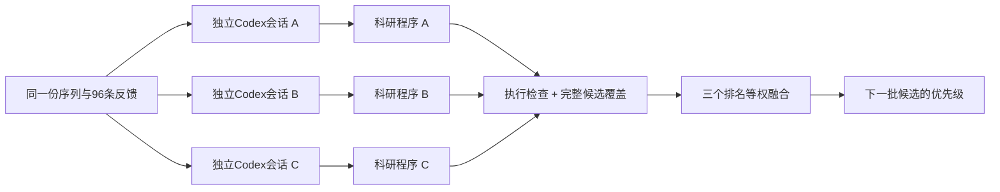

# 为什么需要任务 Harness？

科学家要的是一份值得投入实验的候选清单。通用模型能讨论机制，但从序列、结构、进化信息和少量实验结果中，稳定地生成数百个突变的统一排序，仍然很难。

困难主要有三个：不同实验测的是不同性质；多点突变的组合效应不能总由单点相加；少量反馈允许许多看起来合理、却泛化不同的建模方案。Harness 负责把推理落到可执行的证据分析和预测程序上。

## 改进一：Scientific Program Ensemble

**同一问题，让模型提出三个可检验的科学方案，再组合它们的排名。**

每个会话获得相同的参考序列、实验端点、96条已测反馈和186个未测候选。96条由32个初始单点变体与64个随机历史反馈变体组成。程序可以选择位点模型、理化特征、核方法、非线性模型、读出变换和内部集成，不限制为三个预定公式。

每份程序提交 `proposal.py:propose(case, assignment)`，从传入的反馈重新拟合。执行器检查候选覆盖、有限数值和输出契约；工具工作区阻止读取隐藏结果、其他会话和全局记忆。三个分数先转为平均秩百分位，再等权融合；不会拿测试结果挑最好的程序。

一个具体例子是 GFP 荧光。三个会话围绕位点效应、非线性响应和理化特征提出不同模型，[三份源码](../programs/gfp_s2501/)均已归档。在相同186个候选上，单次Codex **0.5303**，反馈CV选单程序 **0.5433**，程序集成 **0.5819**。这是已有记录的回顾性比较，不是新合成的蛋白验证。

为检查收益是否只是来自更多推理，报告同时比较：预先固定的第一个程序（单次Codex），以及在同样三个程序中用反馈CV选出的一个（相同生成预算）。[详细结果](results.md)

## 改进二：Structure + MSA 输入与工具

**让模型能拿到合适的科学证据，并可靠地调用分析工具。**

| 输入 / 工具 | 能回答什么 | 如何避免误用 |
|---|---|---|
| MSA位点频率与原始比对 | 替换残基在自然同源序列中是否常见？ | 核对WT与残基映射；区分原始深度、有效深度和缺失证据 |
| WT结构坐标与几何摘要 | 突变位点是否埋藏、接触伙伴、受骨架环境约束？ | 核对链和序列；区分静态WT几何与突变后的结构变化 |
| [MSA工具](../tools/msa_tools.py) | 计算相对频率和真实log-odds、逐位点证据完整性 | 部分和与完整得分分别返回；不擅自把缺失频率补成可靠证据 |
| [结构工具](../tools/structure_tools.py) | 位点暴露、距离、接触、原始坐标图与可选SASA计算 | 区分有限近邻摘要与完整接触图；SASA与RSA分开；保留缺失和置信度 |

零样本四组使用相同候选：基础、仅MSA、仅结构、两者联合。每组仍由原生Codex自由选择科学预测方法。工具输出是可用证据，最终的实验目标决定如何解释它们。

例如 AMFR 稳定性：纯序列程序只能提出一般理化先验；联合条件还能分析WT埋藏与接触，并结合自然同源信息，排序相关性从 **0.4340** 提升到 **0.6574**。联合输入并非处处有效：KRAS–RAF1结合与KRAS丰度均出现下降。

结构/MSA实验可以提供原始文件与工具衍生特征。本次对照没有把原始坐标、几何工具和提示组织逐项拆开，因此结果支持“证据与工具整体改进”，不能单独证明LLM直接理解三维坐标。

## 与真实研发的连接

零样本用于尚无本项目实验反馈时的第一轮选择；少样本用于接收实验室结果后的更新。二者都嵌入“设计—制备—测试—学习”循环，候选清单由科学家审核后才进入实验。

本次反馈来自真实公开测量的历史回放，随机抽取，未实现主动选样或新湿实验。两项改进已经分别验证；把它们放进同一个完整闭环，是后续系统集成，而不是本次已完成的联合消融结果。
